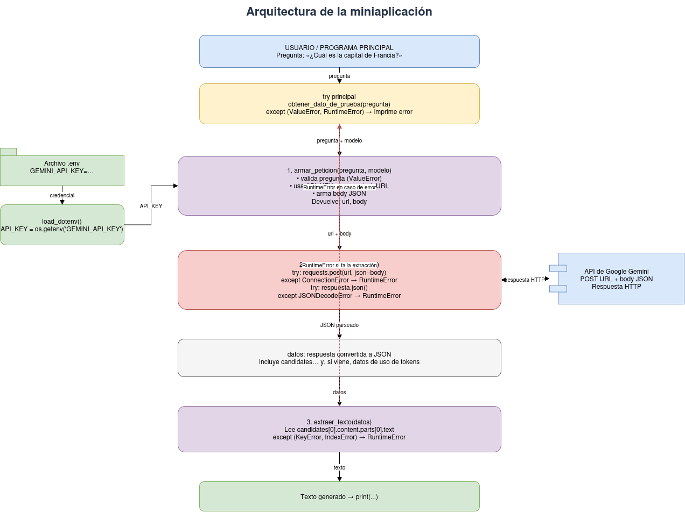

# Decisión de arquitectura: elección de modelo

## Modelo elegido

**`gemini-3.1-flash-lite`** (API de Google Gemini, endpoint `generateContent`).

## Diagrama de arquitectura

El flujo es: la pregunta del usuario pasa por `armar_peticion` (valida y arma URL + body con la API key leída de `.env`), `enviar_peticion` hace el `POST` a la API de Gemini y devuelve el JSON, y `extraer_texto` obtiene el texto generado. Los errores se transforman en `ValueError` / `RuntimeError` y se capturan en el `try` principal. El modelo elegido solo cambia el parámetro `modelo` de `armar_peticion`; el resto de la arquitectura no se modifica.

## Comparación de candidatos

Mediciones hechas el 23-10-2026 con `src/comparar_modelos.py`, que envía **la misma pregunta 4 veces a cada modelo** (16 peticiones autenticadas, con 5 s de pausa entre una y otra):

> Eres un agronomo que trabaja con cerezos en Chile, un agricultor de la región de O'Higgins te pide recomendaciones sobre cual variedad de cerezo plantar en su huerto. Considera el clima, el suelo y la resistencia a enfermedades. Utiliza tu conocimiento experto para dar la mejor recomendación corta y precisa.

Precios tomados de la lista `modelos` en `src/consumir_api.py`. El costo por pregunta se calculó con `calcular_costo` (los tokens de razonamiento se cobran como tokens de salida). La latencia y el costo se promedian solo sobre las peticiones exitosas.

| Criterio | `gemini-3.1-flash-lite` | `gemini-3.5-flash-lite` | `gemini-3.6-flash` |
|---|---|---|---|
| Costo por 1000 tokens de entrada | 0,00025 USD | 0,0003 USD | 0,00075 USD |
| Costo por 1000 tokens de salida | 0,0015 USD | 0,0025 USD | 0,00375 USD |
| Peticiones exitosas | 4/4 | 4/4 | 2/4 (un `503` y un `429`) |
| Costo promedio por pregunta | 0,00078 USD | 0,00108 USD | 0,00639 USD |
| Latencia promedio | 3,14 s | 3,60 s | 12,35 s |
| Latencia mediana (mín – máx) | 3,04 s (2,68 – 3,81) | 3,45 s (3,19 – 4,32) | 12,35 s (11,58 – 13,12) |
| Largo promedio de respuesta | 308 palabras | 234 palabras | 269 palabras |
| Calidad de respuesta | buena: técnicamente coherente y bien redactada (un solo error, "autocértiles"); la variedad recomendada cambia entre ejecuciones | aceptable: contenido correcto, pero con varios errores de redacción ("portainserteo", "Sanfermedades", "bakterial") y un carácter de otro alfabeto | muy buena: la más pulida y consistente (Santina + Lapins en ambas respuestas), sin errores |

Ningún modelo respetó realmente la instrucción de dar una recomendación "corta": todas las respuestas superan las 200 palabras.

Otro candidato de la lista que no se pudo evaluar:

- **`gemini-3.8-flash`**: respondió `429` en los 4 intentos (cuota agotada en el plan gratuito).

## Justificación

- **Costo**: `gemini-3.1-flash-lite` es el más barato por pregunta, cerca de un 28 % menos que `gemini-3.5-flash-lite` y unas 8 veces menos que `gemini-3.6-flash`, cuyos tokens de razonamiento se cobran como salida.
- **Latencia**: es el más rápido (mediana 3,0 s) y el más estable (rango de 1,1 s). `gemini-3.6-flash` tarda unas 4 veces más.
- **Calidad**: para esta miniaplicación entrega respuestas útiles y bien redactadas, mejores en redacción que las de `gemini-3.5-flash-lite`. Su punto débil es la variabilidad: ante la misma pregunta recomienda combinaciones distintas de variedades.
- **Disponibilidad**: respondió `200` en las 4 peticiones, igual que `gemini-3.5-flash-lite` y a diferencia de los modelos más nuevos.

## Alternativas descartadas y por qué

- **`gemini-3.5-flash-lite`** (elegido en la versión anterior de este documento): latencia y disponibilidad similares, pero es más caro y sus respuestas tienen errores de redacción que no aparecen en `gemini-3.1-flash-lite`.
- **`gemini-3.6-flash`**: da las respuestas de mejor calidad y más consistentes, pero cuesta unas 8 veces más, es unas 4 veces más lento y falló en la mitad de las peticiones. Volvería a considerarse si la miniaplicación necesitara respuestas más consistentes o razonamiento de varios pasos, donde ese costo extra sí se justifique.

## Limitaciones de la medición

- La muestra es pequeña: 4 ejecuciones por modelo, y solo 2 respuestas válidas de `gemini-3.6-flash`.
- Se usó una sola pregunta, de dominio agronómico. Conviene repetir `src/comparar_modelos.py` con otras preguntas antes de una decisión definitiva.
- La calidad se evaluó leyendo las respuestas, no con una métrica automática.
